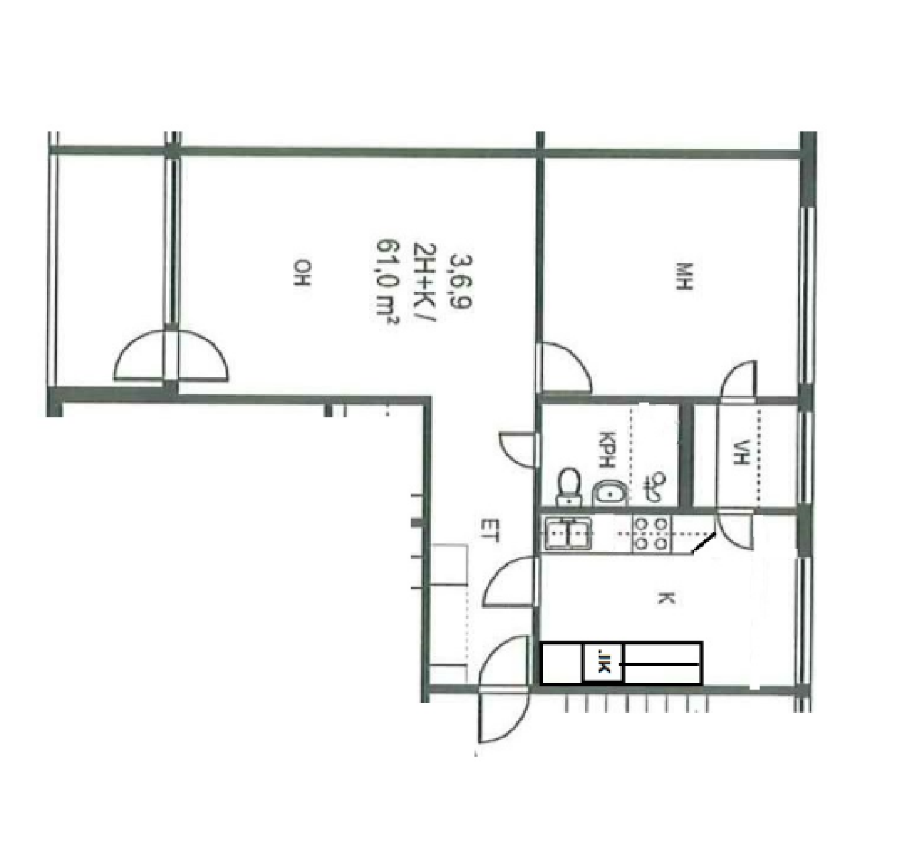
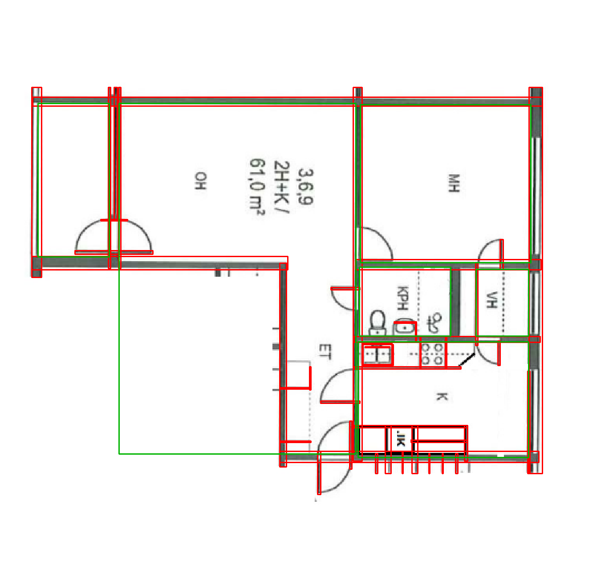
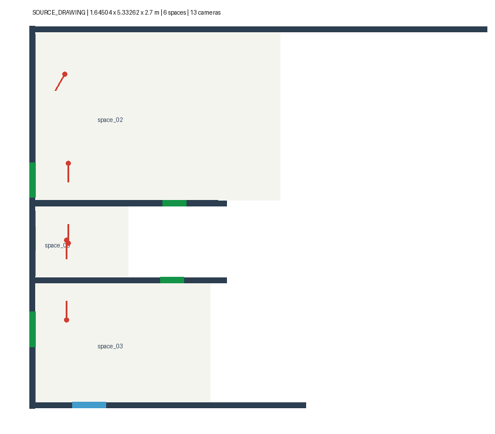
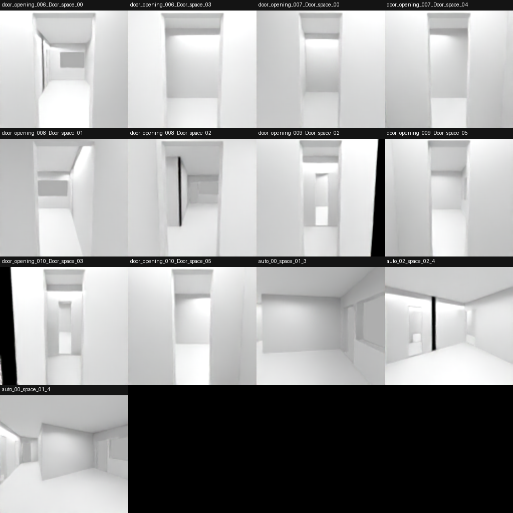
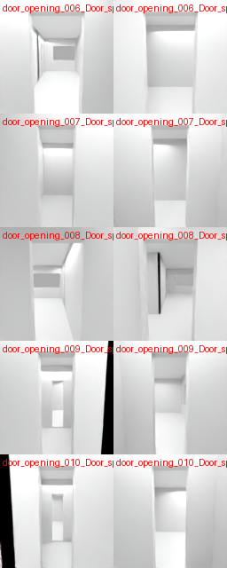

# Baseline 路线 · 验证点

## 路线

`真实完整 Floorplan → CPU Parser → 有界规则修订 → 全局 Metric Scene JSON → 单一 Blender 白膜 GLB → 多视角 RGB / Depth / Object ID / K / T → GenRecon Sage_gt CPU Reader → [待 GPU] GenRecon 3D World`

## 真实图纸：自动栅格 Baseline

| 验证点 | 实测 | 配图 / 数据 |
| --- | --- | --- |
| 完整多房间图纸输入 | 5 张 CubiCasa5K 官方图纸 | [2055](../fixtures/real_floorplans/2055/F1_scaled.png) · [4702](../fixtures/real_floorplans/4702/F1_scaled.png) · [4790](../fixtures/real_floorplans/4790/F1_scaled.png) · [8741](../fixtures/real_floorplans/8741/F1_scaled.png) · [9557](../fixtures/real_floorplans/9557/F1_scaled.png) |
| 墙线 / 房间候选 | 房间框匹配 17/36 | [2055 叠图](../evidence/cpu/real_floorplans/2055_F1_scaled_d55db949/parser/parser_overlay.png) · [4702 叠图](../evidence/cpu/real_floorplans/4702_F1_scaled_6a267a93/parser/parser_overlay.png) · [4790 叠图](../evidence/cpu/real_floorplans/4790_F1_scaled_2c7495d5/parser/parser_overlay.png) · [8741 叠图](../evidence/cpu/real_floorplans/8741_F1_scaled_0935e544/parser/parser_overlay.png) · [逐图评估](../evidence/cpu/real_floorplans/4702_F1_scaled_6a267a93/parser/reference_evaluation.json) |
| 门洞与拓扑 | 0/42 门识别；0/5 形成可信 Metric Scene | [批量结果](../evidence/cpu/real_floorplans/parser_only_batch_summary.json) |
| 有界规则修订 | 6 次可审计线段合并；未调用 Agent 模型 | [修订记录](../evidence/cpu/real_floorplans/4702_F1_scaled_6a267a93/parser/agent_revision.json) · [批量结果](../evidence/cpu/real_floorplans/batch_summary.json) |

## 真实图纸：官方人工标注辅助对照（4702）

| 验证点 | 实测 | 配图 / 数据 |
| --- | --- | --- |
| 全局公制结构 | 6 空间、10 墙、5 室内门、2 外门、4 窗；层高 2.7 m 为假设 | [Metric Scene JSON](../evidence/cpu/real_floorplans/4702_F1_scaled_6a267a93/metric_scene.json) · [原始标注 SVG](../fixtures/real_floorplans/4702/model.svg) |
| 单一建筑白膜 | CPU Blender：1 个统一 GLB | [GLB](../evidence/cpu/real_floorplans/4702_F1_scaled_6a267a93/render_A/building_unified.glb) · [布局 / 相机图](../evidence/cpu/real_floorplans/4702_F1_scaled_6a267a93/layout_camera_map.png) |
| 多视角对齐 | 13 组 RGB / Depth / Object ID / K / T | [RGB 总览](../evidence/cpu/real_floorplans/4702_F1_scaled_6a267a93/render_A/contact_sheet.png) · [Depth](../evidence/cpu/real_floorplans/4702_F1_scaled_6a267a93/render_A/depth/door_opening_006_Door_space_00.png) · [Object ID](../evidence/cpu/real_floorplans/4702_F1_scaled_6a267a93/render_A/object_id/door_opening_006_Door_space_00.png) · [相机元数据](../evidence/cpu/real_floorplans/4702_F1_scaled_6a267a93/render_A/camera_metadata.json) |
| 门洞贯通 / 跨门重投影 | 5/5 通行射线；4/5 结构深度与 ID 重投影通过 | [跨门拼图](../evidence/cpu/real_floorplans/4702_F1_scaled_6a267a93/cross_door_structure.png) · [逐门结果](../evidence/cpu/real_floorplans/4702_F1_scaled_6a267a93/cross_door_structure.json) |
| 官方 Sage_gt CPU Reader | 13 张入选；18/20 Chunk 有接受相机；fallback 2 | [Reader 结果](../evidence/cpu/real_floorplans/4702_F1_scaled_6a267a93/native_A_report.json) · [相机规划](../evidence/cpu/real_floorplans/4702_F1_scaled_6a267a93/camera_plan.json) |

## 合成场景 CPU 回归

| 验证点 | 实测 | 配图 / 数据 |
| --- | --- | --- |
| 4 房间 + 走廊；12 × 9 × 2.7 m | A/B 各 20 视角；30/30 Chunk；0 fallback | [布局 / 相机图](../evidence/cpu/layout_camera_map.png) · [A 白膜](../evidence/cpu/render_A/contact_sheet.png) · [B 粗家具](../evidence/cpu/render_B/contact_sheet.png) · [Reader 结果](../evidence/cpu/native_A_report.json) |
| 4 门双侧观察 / 同物体重投影 | 4/4 通过 | [跨门拼图](../evidence/cpu/cross_door_check.png) · [逐门结果](../evidence/cpu/cross_door_check.json) |
| 异尺寸 / 异原点 / 异拓扑 | 2 房间 + 走廊；6 × 9 × 2.7 m；20/20 Chunk；0 fallback | [布局 / 相机图](../evidence/cpu/alternate/layout_camera_map.png) · [RGB](../evidence/cpu/alternate/render_A/contact_sheet.png) · [跨门拼图](../evidence/cpu/alternate/cross_door_check.png) |
| CPU 自动测试 | 34/34 通过 | [验证记录](validation.md) |

## 未验证

| 验证点 | 状态 | 对应文件 |
| --- | --- | --- |
| 真实图纸自动门窗 / 精确尺度 / 完整拓扑 | 未通过 | [5 图批量结果](../evidence/cpu/real_floorplans/parser_only_batch_summary.json) |
| GenRecon 网络前向 / CFG 消融 / 真实感 3D World | 未运行；需 NVIDIA GPU | [GPU 实验单](gpu_experiments.md) |
| 真实图纸驱动的 GenRecon 跨房间生成一致性 | 未运行 | [GPU 实验单](gpu_experiments.md) |
