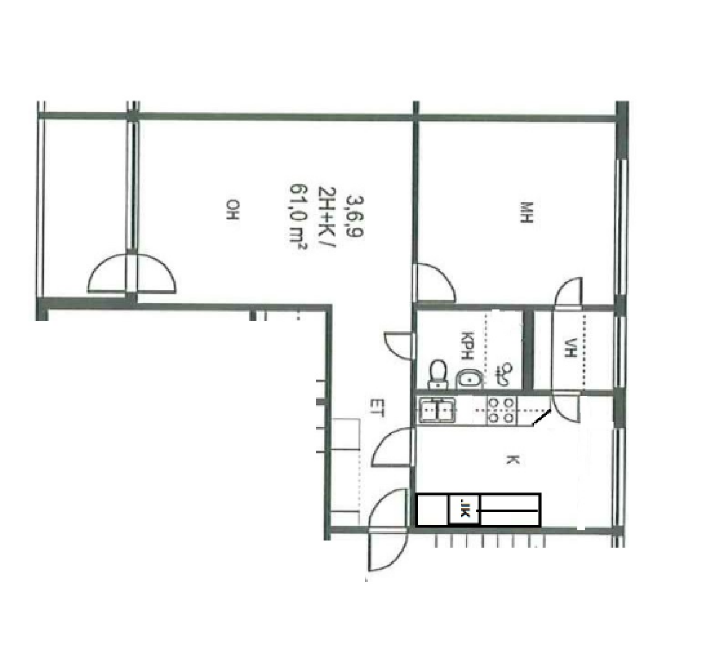
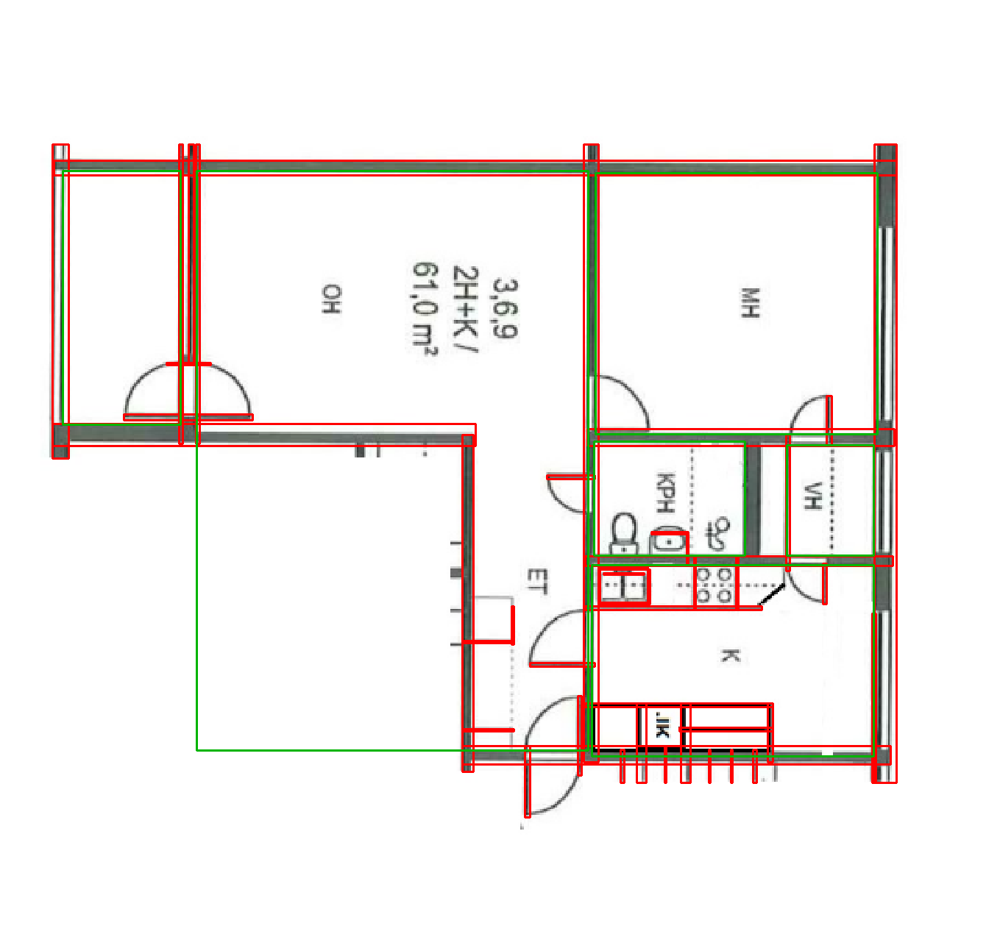
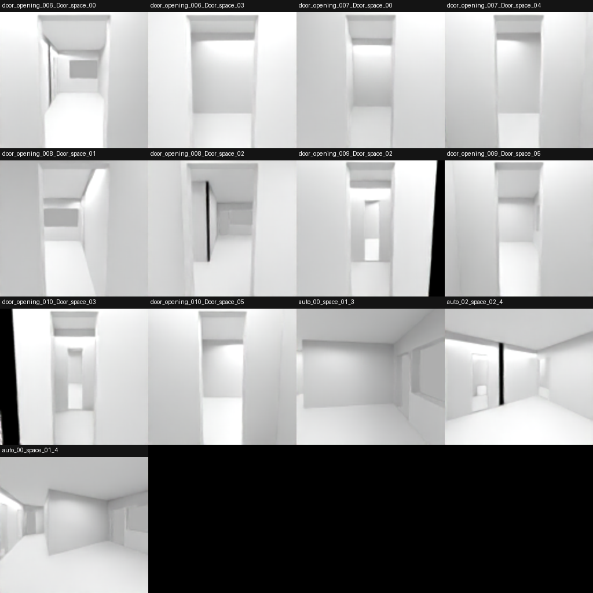
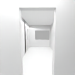
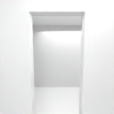
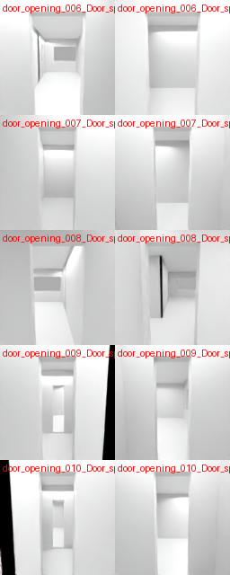

# 平面图 → 单一 Blender 白膜 GLB：效果对比

## 4702：真实图纸 → 结构候选 → 全建筑 GLB

| 原始平面图 | CPU 自动解析 | Blender 单一白膜 GLB 预览 |
| --- | --- | --- |
|  |  |  |
| 真实完整图纸 | OpenCV 墙线 / 房间候选；未产出可信门洞 | **官方人工 SVG 标注辅助**；非 AI 自动生成 |

| 单一 GLB | 全建筑布局 | 白膜多视角 |
| --- | --- | --- |
| [下载 building_unified.glb](../evidence/cpu/real_floorplans/4702_F1_scaled_6a267a93/render_A/building_unified.glb) |  |  |
| glTF 2.0 binary；42,900 bytes | 6 空间 / 10 墙 / 5 室内门 | 同一 Blender Scene |

## 门洞两侧：同一 GLB

| 门一侧 | 门另一侧 | 跨门结构检查 |
| --- | --- | --- |
|  |  |  |
| 同一建筑场景 | 同一建筑场景 | 通行射线 5/5；深度 + ID 重投影 4/5 |

## 五张真实图纸：自动建模状态

| 图纸 | 原图 | 自动解析叠图 | 自动生成单一 GLB |
| --- | --- | --- | --- |
| 2055 | [查看](../fixtures/real_floorplans/2055/F1_scaled.png) | [查看](../evidence/cpu/real_floorplans/2055_F1_scaled_d55db949/parser/parser_overlay.png) | 未通过 |
| 4702 | [查看](../fixtures/real_floorplans/4702/F1_scaled.png) | [查看](../evidence/cpu/real_floorplans/4702_F1_scaled_6a267a93/parser/parser_overlay.png) | 未通过；**标注辅助 GLB 已生成** |
| 4790 | [查看](../fixtures/real_floorplans/4790/F1_scaled.png) | [查看](../evidence/cpu/real_floorplans/4790_F1_scaled_2c7495d5/parser/parser_overlay.png) | 未通过 |
| 8741 | [查看](../fixtures/real_floorplans/8741/F1_scaled.png) | [查看](../evidence/cpu/real_floorplans/8741_F1_scaled_0935e544/parser/parser_overlay.png) | 未通过 |
| 9557 | [查看](../fixtures/real_floorplans/9557/F1_scaled.png) | [查看](../evidence/cpu/real_floorplans/9557_F1_scaled_f13ce9ed/parser/parser_overlay.png) | 未通过 |

| 验收点 | 当前结果 | 证据 |
| --- | --- | --- |
| 真实图纸自动解析 → 公制场景 → 单一 GLB | 0/5 | [批量结果](../evidence/cpu/real_floorplans/batch_summary.json) |
| 官方人工标注辅助 → 公制场景 → 单一 GLB | 4702 已生成 | [官方 SVG](../fixtures/real_floorplans/4702/model.svg) · [Metric Scene](../evidence/cpu/real_floorplans/4702_F1_scaled_6a267a93/metric_scene.json) · [GLB](../evidence/cpu/real_floorplans/4702_F1_scaled_6a267a93/render_A/building_unified.glb) |
