# 平面图 → AI 建模效果对比

## 真实图纸 4702：输入、自动解析、标注辅助白膜

| 原始完整平面图 | CPU 自动解析候选 | 官方人工 SVG 标注辅助的 Blender 白膜 |
| --- | --- | --- |
|  |  | 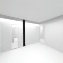 |
| 官方真实图纸 | OpenCV 墙线 / 房间候选；**未识别可信门洞** | 统一建筑白膜；**使用人工 SVG 标注，不是 AI 自动建模结果** |

| 全建筑布局与相机 | 门洞两侧白膜 RGB | 跨门结构对照 |
| --- | --- | --- |
| 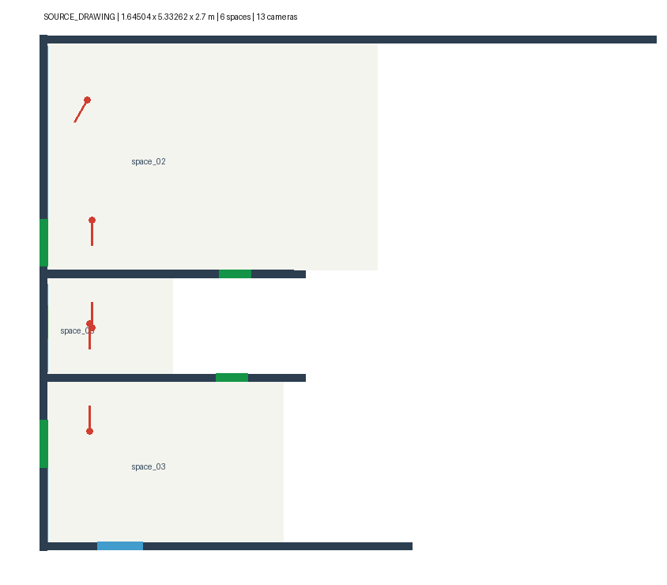 |  |  |
| 6 空间 / 10 墙 / 5 室内门 | Blender CPU，13 视角 | 穿门射线 5/5；深度 + ID 重投影 4/5 |

| RGB | Depth | Object ID |
| --- | --- | --- |
|  | 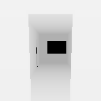 |  |

## 另外四张真实图纸：原图与自动解析效果

| 图纸 | 原图 | CPU 解析叠图 | 白膜 |
| --- | --- | --- | --- |
| 2055 | 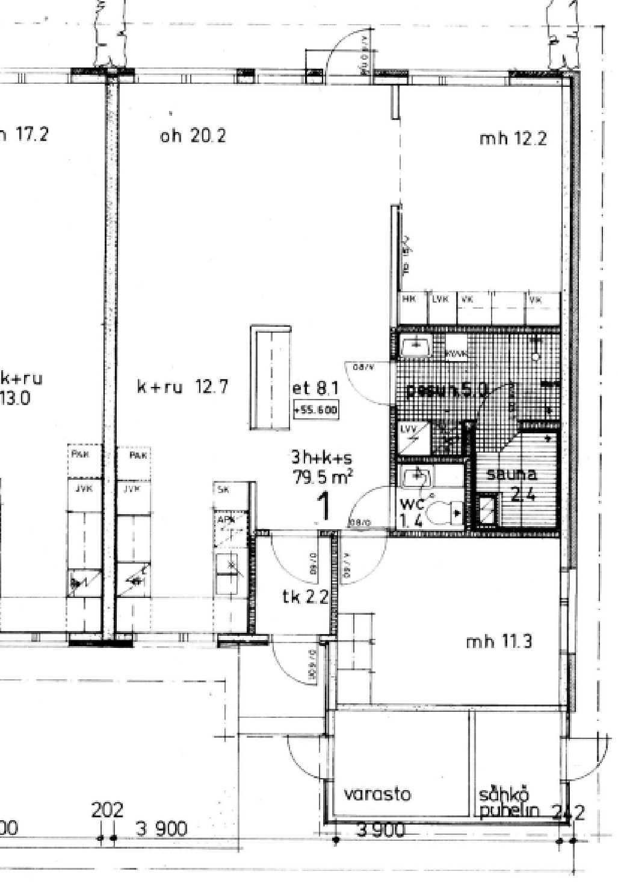 | 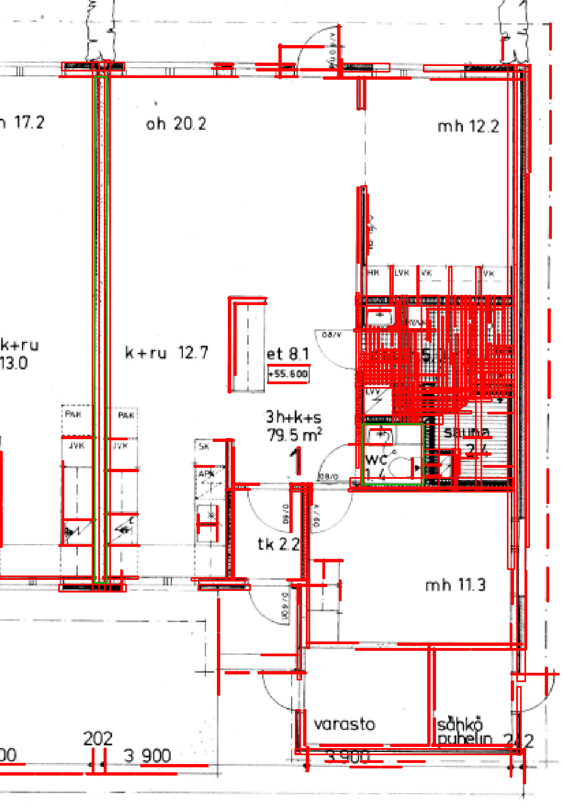 | 未生成可信 Metric Scene |
| 4790 | 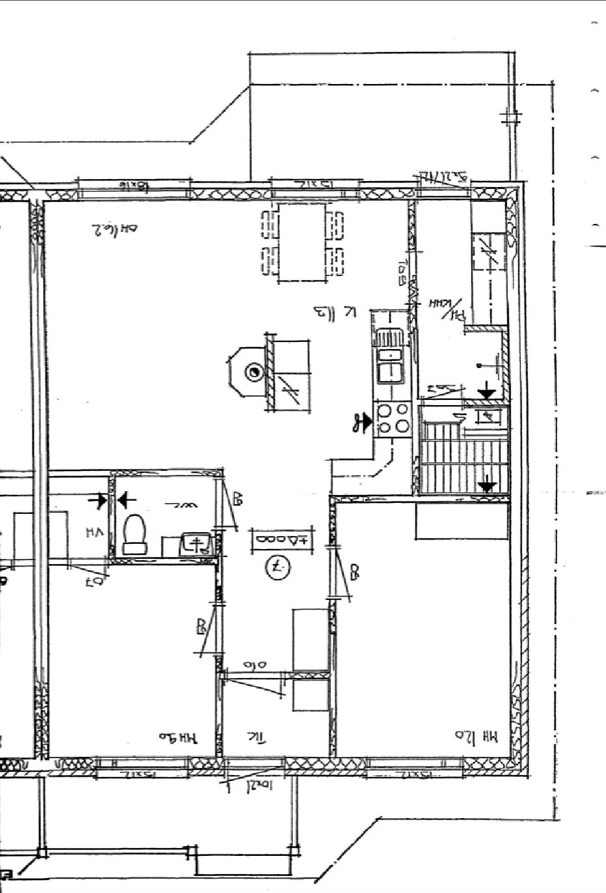 | 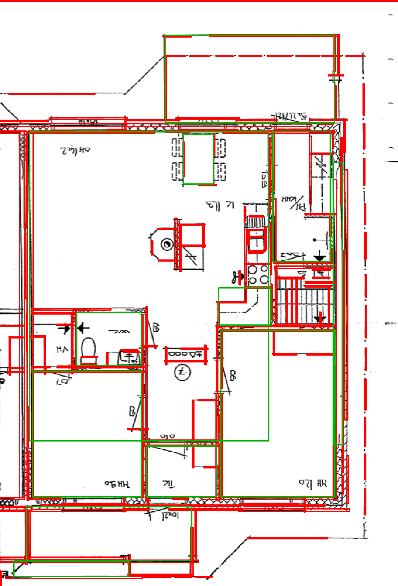 | 未生成可信 Metric Scene |
| 8741 | 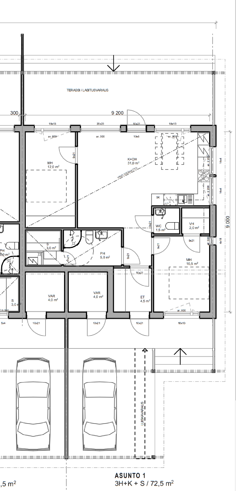 | 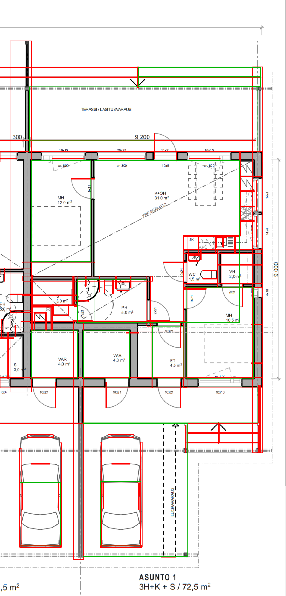 | 未生成可信 Metric Scene |
| 9557 | 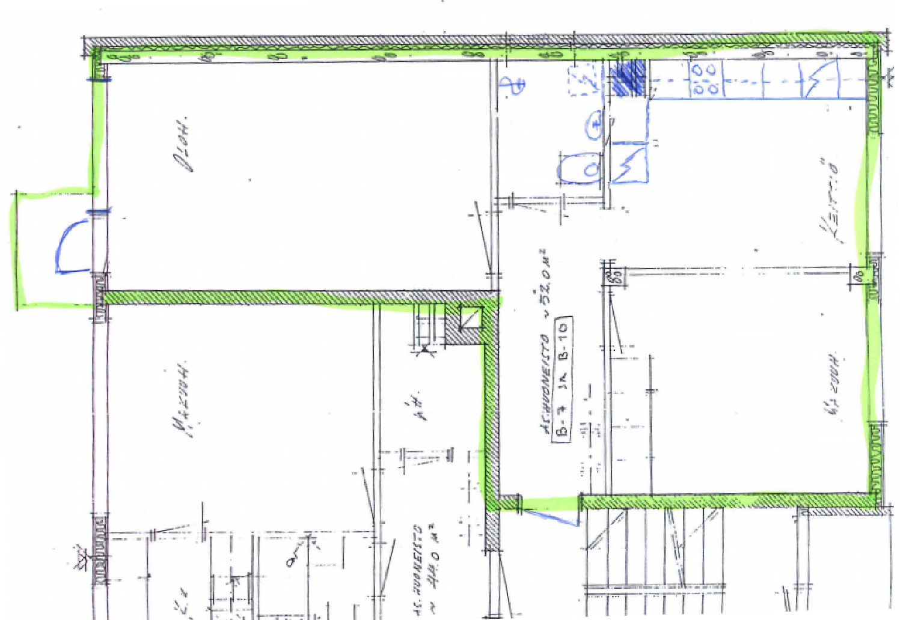 | 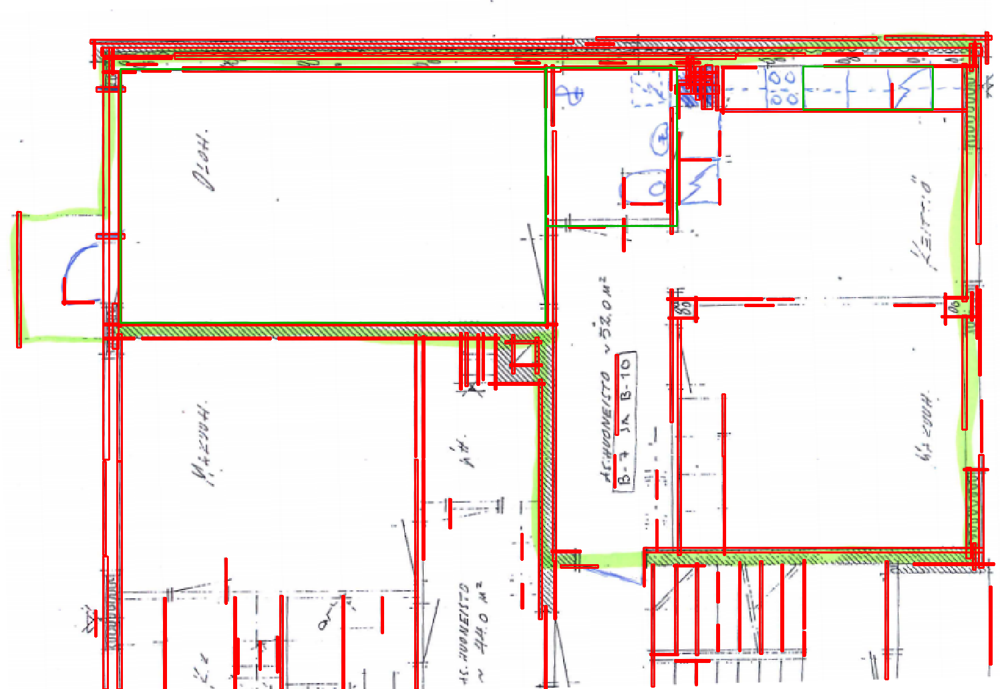 | 未生成可信 Metric Scene |

## 效果与验收状态

| 项目 | 实测结果 | 证据 |
| --- | --- | --- |
| 5 张真实图纸的自动房间框 | 17/36 匹配 | [批量评估](../evidence/cpu/real_floorplans/parser_only_batch_summary.json) |
| 5 张真实图纸的自动门洞 | 0/42 | [批量评估](../evidence/cpu/real_floorplans/parser_only_batch_summary.json) |
| 真实图纸 → 自动 Metric Scene → 白膜 | 0/5 完整通过 | [批量结果](../evidence/cpu/real_floorplans/batch_summary.json) |
| 4702 人工标注辅助 → Blender 白膜 | 已运行；统一 [GLB](../evidence/cpu/real_floorplans/4702_F1_scaled_6a267a93/render_A/building_unified.glb) | [Metric Scene](../evidence/cpu/real_floorplans/4702_F1_scaled_6a267a93/metric_scene.json) · [13 视角](../evidence/cpu/real_floorplans/4702_F1_scaled_6a267a93/render_A/contact_sheet.png) |
| 4702 → GenRecon Sage_gt CPU Reader | 18/20 Chunk 有接受相机；2 fallback | [Reader 报告](../evidence/cpu/real_floorplans/4702_F1_scaled_6a267a93/native_A_report.json) |
| GenRecon 网络生成的真实感 mesh / PBR | **未运行；无效果图** | [GPU 实验单](gpu_experiments.md) |

## 合成建筑控制组（非真实图纸）

| 结构白膜 A | 粗家具白膜 B | 跨门重投影 |
| --- | --- | --- |
| 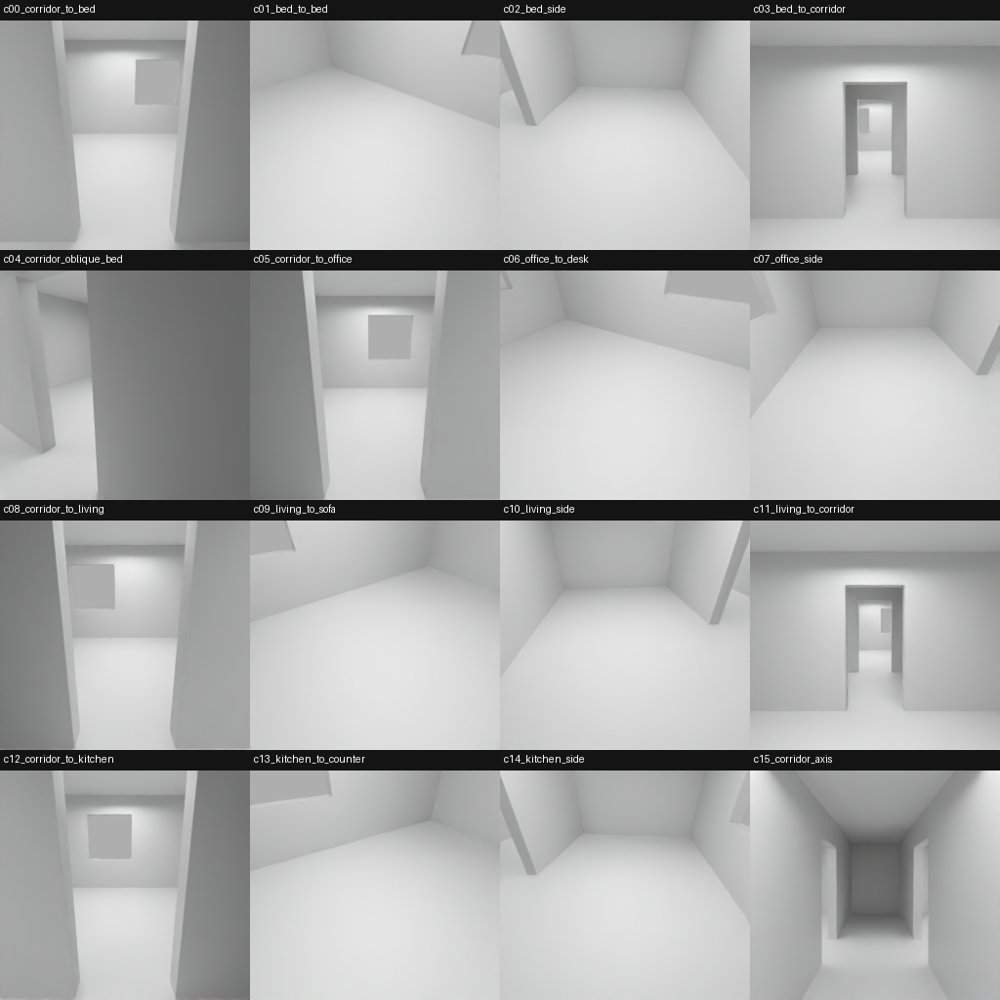 | 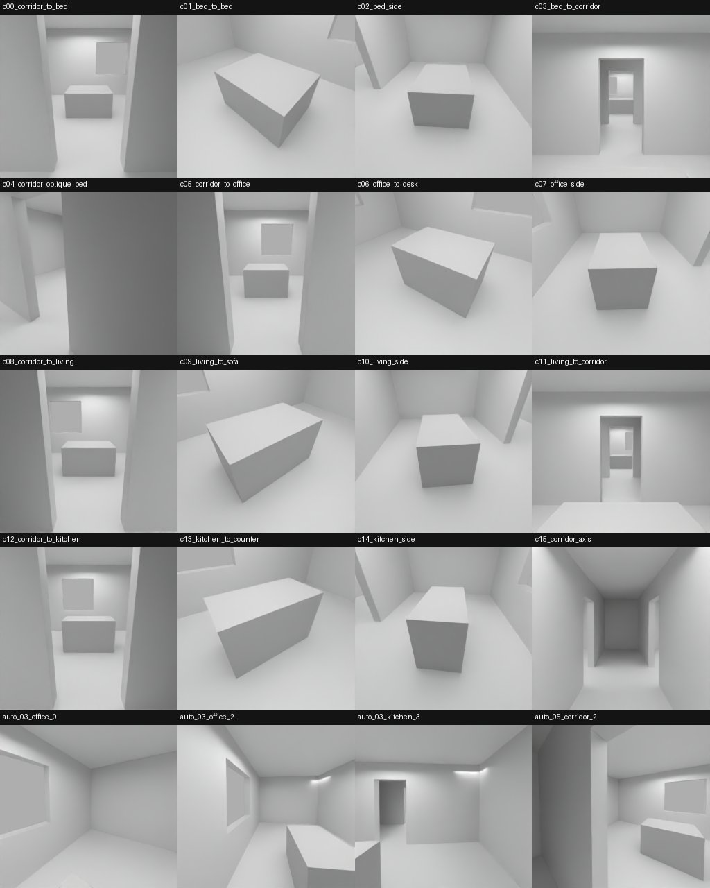 | 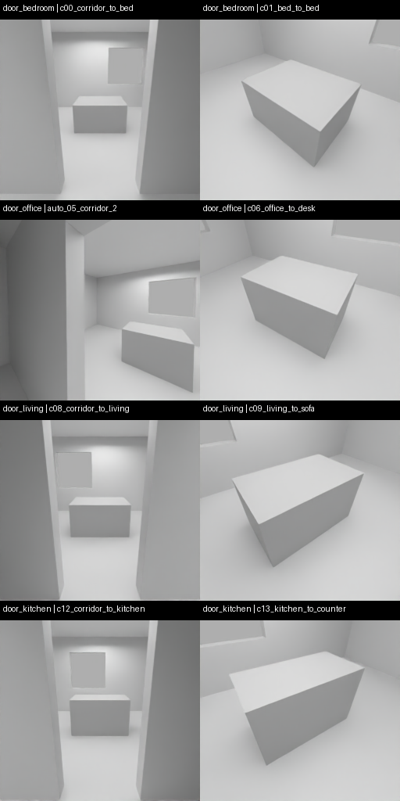 |
| 20 视角；30/30 Chunk；0 fallback | 同相机；30/30 Chunk；0 fallback | 4/4 门通过；**仅验证 Blender 场景** |
